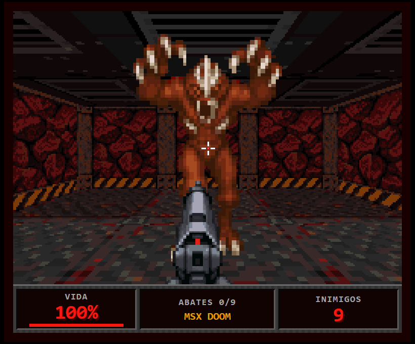
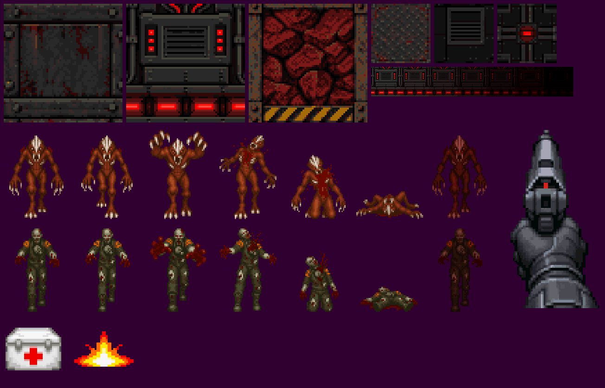
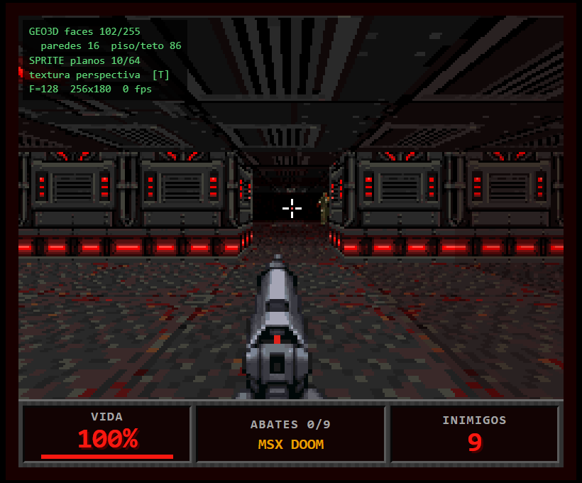

# MSX DOOM — protótipo V9968 / Geo3D

Jogo de tiro em primeira pessoa 2.5D, estilo Doom, numa base marciana. Tem duas partes:

- **`msx/`: o jogo para MSX** com o cartucho **V9968 + Geo3D**, em Z80, num MegaROM de
  256 KB. Roda no openMSX (fork V9968 + geo3d); ainda não foi testado em hardware real.
  Ver **[msx/README.md](msx/README.md)**; para jogar, `msx\jogar_openmsx.bat`.
- **A raiz: o protótipo de navegador** (HTML + CSS + JavaScript com Three.js) que serviu de
  referência visual e de orçamento: resolução, paleta, formato da arte, sombreamento e
  contagem de polígonos seguem o que o hardware faz. O cartucho usa o mesmo mapa
  (`js/game.js`) e a mesma arte convertida (`assets/msx/`).

| MSX (openMSX, V9968 + Geo3D) | Protótipo (navegador) |
|---|---|
|  |  |

O resto deste arquivo descreve o protótipo.

## Como rodar

Dê duplo clique em `index.html`. Não precisa de servidor, Node nem instalação: o Three.js
está em `vendor/` e toda a arte vai embutida em `js/assets.js`.

| Ação | Controle |
|---|---|
| Andar / deslocar de lado | Teclas de cursor (também W A S D) |
| Olhar | Mouse (clique na tela para travar o ponteiro) |
| Atirar | Botão esquerdo ou ESPAÇO (gatilho A do MSX) |
| Girar sem mouse | Q / E |
| Painel de orçamento Geo3D | F1 |
| Textura afim (como no Geo3D) / com perspectiva | T |
| Som liga/desliga | M |
| Soltar o mouse / pausar | ESC |

Objetivo: abater os 9 inimigos. Kits médicos devolvem 25 de vida.

## Arquivos

```
index.html            página (palco 256x212, janela 3D, barra de status, telas)
css/style.css         layout em "pixels MSX" (--u = 1 pixel do SCREEN 8 ampliado)
js/game.js            o jogo: mapa, visibilidade, faces, inimigos, tiro, HUD, som
js/assets.js          GERADO: arte indexada + paleta EPAL em base64
vendor/three.min.js   Three.js r149 (build clássico, funciona em file://)
assets/src/           originais do Higgsfield (PNG 1024 px)
assets/msx/           arte convertida para o MSX (ver abaixo)
tools/build_assets.ps1  conversor Higgsfield -> MSX (PowerShell + C#, sem dependências)
tools/selftest.js     autoteste (index.html?selftest=1)
```

## O que o protótipo copia do hardware

Fontes: `V9968_Cartridge/geo3d/README.md`, `geo3d/rtl/geo3d_engine.v`,
`geo3d/docs/BASIC_API.md` e `vector-raid/game/docs/engine.md`. Os dados do sprite modo 3
vêm dos slides do devcon do V9968; conjunto de paleta, ampliação e espelhamento foram
conferidos na RTL (`vdp_sprite_info_collect.v`), largura de 16 px e 15 cores não.

| Hardware | No protótipo |
|---|---|
| SCREEN 8, 256x212 | Palco de 256x212; janela 3D de 256x180 (registradores W/H do Geo3D) + barra de status de 32 linhas |
| EPAL: paleta de 256 entradas x 15 bits (R#20 bit 4) | Toda cor sai de uma paleta de 256 entradas RGB555. O shader consulta `paleta[conjunto][índice]`; não existe textura RGB no jogo |
| Geo3D: quads texturizados, afim, sem z-buffer | O mundo é uma lista de quads de 1 célula. Tecla T liga a interpolação afim |
| Luz chapada por face, nível 0..6, 7 cópias pré-sombreadas a `TSTRIDE` linhas | Um nível inteiro 0..6 por quad; cada nível é um conjunto de paleta (0 a 6) |
| Uma origem de textura por RUN, U/V de 8 bits | As 6 texturas do mundo cabem num atlas de 256x64 |
| Máximo de 255 faces por RUN | Só os quads das células à vista entram na lista; acima de 255 os mais distantes caem. F1 mostra a contagem |
| Sprites modo 3: planos de 16 px de largura, 15 cores + transparente, 16 conjuntos de paleta, escala por plano | Inimigos 48x64 (3 planos), arma 64x128 (4 planos), itens 32x32 (2 planos), cor 0 transparente, um conjunto por personagem |
| Registrador F (distância focal) | F = 128, ou 90 graus de campo de visão horizontal |
| Cursores + ESPAÇO (como no VECTOR RAID) | Mesmas teclas |

### Organização da paleta (16 conjuntos de 16 cores)

| Conjunto | Uso |
|---|---|
| 0 a 6 | Mundo, um conjunto por nível de luz. As 6 texturas dividem as mesmas 16 cores |
| 7 / 8 | Demônio: normal / no escuro |
| 9 / 10 | Técnico possuído: normal / no escuro |
| 11 | Arma |
| 12 | Kit médico e clarão do tiro |
| 13 | HUD (cores do TMS9918) |
| 14, 15 | Livres |

A iluminação vermelha vem da própria rampa de luz: ao escurecer, verde e azul caem mais
rápido que o vermelho, então as áreas longe das lâmpadas ficam vermelho-escuras em vez de
pretas (função `Shade` em `tools/build_assets.ps1`).

## Arte: Higgsfield -> MSX

Personagens e tiles foram gerados no Higgsfield com o modelo `gpt_image_2_5` (qualidade
baixa, 1k, fundo transparente nos sprites). Foram 20 imagens, 5,0 créditos no total:

- 5 tiles: parede de aço, painel técnico, rocha com faixa de perigo, piso, teto com luminária;
- 2 inimigos com 6 quadros cada (2 de caminhada, ataque, dor, morrendo, morto). O primeiro
  quadro foi gerado por texto e os outros 5 usando o primeiro como imagem de referência,
  para manter desenho, paleta e escala;
- pistola em primeira pessoa, clarão do tiro e kit médico.

`tools/build_assets.ps1` converte tudo:

1. tiles: recorta uma célula do padrão e reduz para 64x64 (paredes) ou 32x32 (piso e teto);
2. sprites: corta o halo pelo canal alfa (50 %), enquadra o personagem e o apoia na base do quadro;
3. quantiza para 16 cores em 15 bits (corte mediano + k-means), uma paleta por folha;
4. grava índices, paleta, atlas e o `js/assets.js`.

```
powershell -ExecutionPolicy Bypass -File tools\build_assets.ps1
```

Saída em `assets/msx/`:

| Arquivo | Conteúdo |
|---|---|
| `palette.pal` | 256 x 3 bytes (R, G, B de 5 bits), na ordem que a porta 2 espera com EPAL ligado |
| `world_atlas.sc8` | 256x448 pixels de SCREEN 8: as 6 texturas em 7 cópias de luz (`TSTRIDE` = 64). Carregável direto numa página livre da VRAM |
| `*.idx` | 1 byte por pixel, índice local 0..15 (somar 16 x conjunto para o índice EPAL) |
| `*.png`, `_preview.png`, `world_atlas.png`, `palette.png` | Prévias com as cores exatas |
| `manifest.json` | Tamanhos, conjuntos de paleta e posições no atlas |



## Orçamento medido

Números do autoteste (`index.html?selftest=1`), que varre as 229 células livres em 16
direções e deixa um bot jogar a fase:

| Item | Medido | Limite |
|---|---|---|
| Faces por quadro, pior caso | 147 | 255 por RUN |
| Faces por quadro, média | 52 | |
| Atlas de texturas na VRAM | 114.688 bytes | páginas 2 e 3 do SCREEN 8 = 131.072 |
| Padrões de sprite (4 bpp) | 23.552 bytes | |
| Planos de sprite numa cena típica | 8 a 12 | 64 |

## Do protótipo ao cartucho

O protótipo valida arte, paleta e contagem de faces. A lista abaixo é a que ele deixava em
aberto para o port; `msx/README.md` conta como cada ponto ficou no cartucho. Em resumo: o
plano próximo é resolvido por recorte no Z80 só nas paredes vizinhas ao jogador; os
inimigos são faces texturizadas do Geo3D com transparência (TIMP), ordenadas junto com as
paredes, e não sprites modo 3; o nível de luz por face usa a normal sintética; a
visibilidade é pré-calculada; piso e teto viraram degradê liso (HMMV), a maior diferença
visual; e sem piso e teto o pior caso cai para menos de 90 faces por quadro.

Os pontos, como estavam antes do port:

- **Plano próximo.** O Geo3D descarta a face inteira se um vértice fica atrás de `ZNEAR`;
  não há recorte 3D. Paredes e piso junto do jogador sumiriam. O Three.js recorta
  normalmente, então aqui o problema não aparece. É o maior risco do port.
- **Sem z-buffer.** O Geo3D ordena as faces do fundo para a frente; o protótipo usa
  z-buffer. Sprites são desenhados por cima do bitmap, então um inimigo meio escondido
  atrás de uma quina precisa de recorte por software.
- **Nível de luz por face.** O Geo3D calcula o nível a partir da normal e de uma luz
  direcional. Para escolher o nível de cada quad (lâmpadas, distância), o Z80 teria que
  enviar uma normal sintética, como o demo de texto em perspectiva já faz.
- **Tempo de quadro.** O teto do VECTOR RAID é de 96 faces enviadas por quadro; o pior caso
  daqui (147) pede dividir em dois quadros, encurtar o alcance de visão ou pintar piso e
  teto com cor lisa (HMMV), como no Wolfenstein.
- **16 planos de sprite por linha.** Não é simulado. Arma (4) mais 4 inimigos na mesma
  linha (12) já enche.
- **Sprite modo 3 e EPAL** ainda não rodaram em hardware real, e o suporte no openMSX não
  foi conferido contra a RTL (ver `BASIC_API.md`).
- Som: ondas quadradas e ruído via WebAudio, só para lembrar o PSG. Não há música.

## Depuração

Parâmetros de URL: `autostart=1` (começa sem travar o mouse), `debug=1` (painel F1),
`affine=1`, `freeze=1` (inimigos parados), `god=1`, `pose=x,z,graus`, `selftest=1`.
No console, `MSXDOOM` expõe jogador, inimigos, estatísticas e as funções do jogo.


