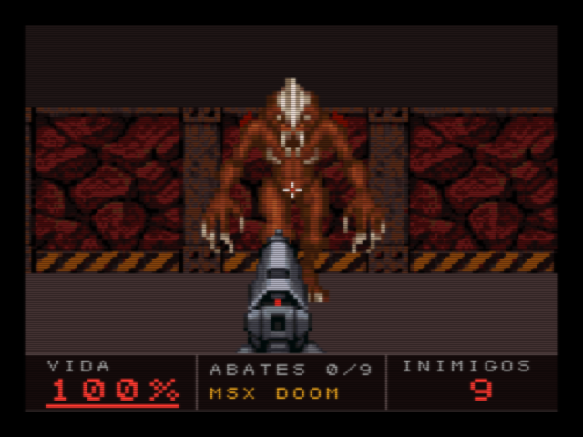
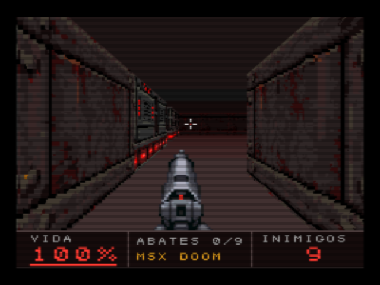
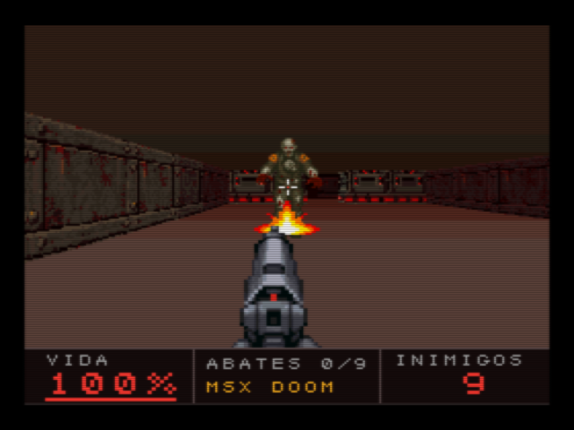

# MSX DOOM — cartucho para MSX com V9968 + Geo3D

A versão de MSX do protótipo de navegador que está na raiz deste projeto: um jogo de tiro
em primeira pessoa em Z80, num MegaROM de 256 KB, que usa o **Geo3D** para projetar,
ordenar e texturizar as paredes e os inimigos, e o **V9968** para pintar.





Mesma fase, mesma arte e mesmas regras do protótipo: 9 inimigos (demônios e técnicos
possuídos), 3 kits médicos, pistola. As capturas acima são do openMSX, não do navegador.

## Como rodar

| | |
|---|---|
| No openMSX (Windows) | duplo clique em `jogar_openmsx.bat` |
| Linha de comando | `openmsx -machine C-BIOS_V9968_JP -ext geo3d -cart release/MSXDOOM_98.ROM -romtype ASCII16` |
| Perfil do cartucho real | `openmsx -machine C-BIOS_MSX2+ -ext HRA_V9968 -ext geo3d88 -cart release/MSXDOOM_88.ROM -romtype ASCII16` |
| Hardware real | `release/MSXDOOM_88.ROM` num cartucho flash (mapper **ASCII16**), com o cartucho V9968 + Geo3D em 88h. A imagem sai no HDMI do cartucho |

O emulador é o fork V9968 + geo3d do openMSX (`C:\Projects\mmsoft\openmsx-geo3d`).

| Ação | Teclado | Joystick 1 |
|---|---|---|
| Andar para frente / trás | cursor ↑ ↓ | cima / baixo |
| Girar | cursor ← → | esquerda / direita |
| Passo lateral | Z / X | botão B + esquerda / direita |
| Atirar, começar | ESPAÇO (ou RETURN para começar) | botão A |

## Como compilar e testar

Tudo roda no WSL (Ubuntu) só com `z80asm` 1.8 e `python3`, sem pacotes extras:

```
wsl -e bash -lc "cd /mnt/c/Projects/mmsoft/MSXDOOM/msx && bash build.sh"
wsl -e bash -lc "cd /mnt/c/Projects/mmsoft/MSXDOOM/msx && bash tests/run_tests.sh"
```

`build.sh` gera os dados (`tools/gen_data.py`, quando o mapa, a arte ou as ferramentas
mudam), monta as duas ROMs e copia para `release/`. O mapa vem de `js/game.js` e a arte de
`assets/msx/`: mudar a fase no protótipo muda a fase do cartucho.

`tests/run_tests.sh` roda a ROM no openMSX sem janela e confere:

| Cenário | O que confere |
|---|---|
| `poses` | Congela o jogo em 18 poses e compara a página pintada com `tools/sim.py`, que passa a mesma cena pelo **modelo de referência do Geo3D** (`geo3d/sim/gen_scenes.py`). Tem que dar os mesmos bytes |
| `combat` | Atira no primeiro zumbi até cair: tiro, som no PSG, lógica dos inimigos, contagem |
| `medkit` | Jogador ferido passa por cima de um kit médico |
| `death` | Fica parado ao lado de um demônio até morrer; tela final e recomeço |
| `win` | Abate o último inimigo: tela final |
| `prof` | Tempo de cada etapa do quadro (ver "Tempo de quadro") |

`PROFILE=88` roda a ROM de 88h com `-ext HRA_V9968 -ext geo3d88`. `SHOT=1` abre a janela e
grava capturas. Resultado em 6 de outubro de 2026, nos dois perfis: **18 de 18 poses
idênticas ao modelo**, todos os cenários passam.

## Como o quadro é feito

SCREEN 8 (256x212, 1 byte por pixel) com a paleta estendida do V9968 (EPAL: 256 entradas
de 15 bits), duas páginas trocadas no retraço vertical. Janela 3D de 256x180 e barra de
status de 32 linhas, como no protótipo. A cada quadro, na página escondida:

1. **Teto e piso**: 16 faixas HMMV em degradê (escurece para o horizonte). Sem textura.
2. **Paredes e inimigos**: **um único RUN do Geo3D**, com faces texturizadas. O Geo3D
   projeta os vértices, descarta as faces de costas, ordena do fundo para a frente e manda
   um LRMM por linha para o V9968. A operação lógica é TIMP: o texel 0 é furo. Por isso os
   inimigos, os kits e o impacto do tiro também são faces (sempre de frente para a câmera)
   e entram na mesma ordenação: um inimigo atrás de uma quina fica escondido de graça.
3. **Pistola, clarão e mira**: cópias LMMM + TIMP da área de textura.
4. **Barra de status**: só quando um número muda, por cópias HMMM de dígitos e mensagens
   desenhados uma vez numa área da VRAM que nunca é exibida.

Efeitos de tela cheia são regravações da paleta (768 bytes): dano em vermelho, kit médico
em verde, e o clarão do tiro, que sobe um nível de luz no mundo inteiro.

### O que o Z80 faz (e o que não faz)

O Z80 não lança raios nem ordena nada. O que cada problema do protótipo virou:

| Problema | Solução no cartucho |
|---|---|
| **Visibilidade** (o protótipo lança 192 raios por quadro) | Pré-calculada na build. Para cada uma das 229 células livres, `gen_data.py` lança raios de 25 pontos da célula e guarda as faces de parede alcançadas, já com o nível de luz visto dali. O Z80 só filtra a lista pelo ângulo de visão |
| **Plano próximo** (o Geo3D descarta a face inteira se um vértice fica atrás de ZNEAR) | As paredes das 3x3 células em volta do jogador vão ao Geo3D ao entrar na célula, cada uma em quatro tiras de 64 unidades. A cada quadro o Z80 calcula a profundidade dos 16 cantos da vizinhança (2 multiplicações e 16 somas) e, para cada parede que cruza Z = 16, acrescenta uma face: do cruzamento até o fim da tira onde ele cai, a única que o Geo3D pode ter descartado com um pedaço à vista. As demais faces estão a mais de uma célula e nunca cruzam o plano |
| **Textura afim** (sem correção de perspectiva) | As tiras de 64 unidades das paredes próximas; as distantes a menos de 3,2 células vão em duas metades |
| **Nível de luz por face** | Luz do Geo3D apontada para cima, (0, 1, 0), e normal sintética (0, ny, 0): como a câmera só gira em torno do eixo vertical, `ny` escolhe o nível 0 a 5 sem depender da direção do olhar. O nível escolhe a cópia pré-sombreada da textura |
| **Inimigos atrás de paredes** | São faces do mesmo RUN (ver acima). Para os quadros dos inimigos, o "nível de luz" é só parte do endereço da linha na área de textura |
| **Limite de 255 vértices e 255 faces por RUN** | Pior caso: 67 faces fixas (158 vértices) + 8 faces de cruzamento (16 vértices) + 13 objetos (52 vértices). Cabe |
| **Caminho dos inimigos** (o protótipo faz uma busca em largura) | Tabela pronta de 2 bits por par de células: o próximo passo de qualquer célula até a do jogador (13 KB) |
| **Trigonometria** | Tabela de senos em Q2.14; por quadro, 4 multiplicações para a translação da câmera e 2 para a vizinhança |

As tiras próximas e as faces distantes ficam na RAM do Geo3D: as tiras são reenviadas
quando o jogador muda de célula, as distantes também quando ele gira mais de 34 graus. Por
quadro seguem as faces de cruzamento, os objetos, a matriz e a translação (24 bytes) e o
RUN.

A ordem do quadro evita esperas ociosas: a geometria do quadro seguinte vai para a RAM do
Geo3D enquanto o anterior espera o retraço para ser mostrado, e a lógica do jogo roda
enquanto o Geo3D desenha. Essa organização saiu do estudo do código do Wolfenstein 3D:
**[docs/wolf3d-engenharia-reversa.md](docs/wolf3d-engenharia-reversa.md)**.

`tools/sim.py` é o mesmo algoritmo em Python, com a mesma aritmética inteira. Serve de
especificação do `src/render.asm` e de gabarito dos testes.

### VRAM

| Linhas (SCREEN 8) | Conteúdo |
|---|---|
| 0–211 e 256–467 | As duas páginas de vídeo |
| 212–251 | Dígitos e mensagens da barra de status (nunca exibidos) |
| 512–895, colunas 0–191 | 3 texturas de parede de 64x64 em 6 níveis de luz (`TSTRIDE` = 64) |
| 512–895, colunas 192–255 | Pistola (64x128), corpos dos dois inimigos, kit médico, clarão |
| 896–1023 | 5 quadros de cada inimigo (48x64) e a mira |

### Paleta (16 conjuntos de 16)

| Conjunto | Uso |
|---|---|
| 0 | Cor 0 (transparente e borda) e as cores da barra de status |
| 1–6 | Mundo, um conjunto por nível de luz (são os conjuntos 1 a 6 do protótipo) |
| 7, 9 | Demônio, técnico possuído |
| 11, 12 | Pistola; kit médico e clarão |
| 14, 15 | Degradê do teto e do piso (8 tons cada, calculados da cor média das texturas) |

### ROM (ASCII16, 16 bancos de 16 KB)

| Banco | Conteúdo |
|---|---|
| 0 | Código e as tabelas que a interrupção e todas as rotinas usam (10 KB dos 16) |
| 1 | 4 paletas, visibilidade entre células, ponteiros das listas de faces |
| 2 | Próximo passo dos inimigos |
| 3–5 | Listas de faces por célula (35 KB) |
| 6–13 | Área de textura (128 KB), copiada para a VRAM na partida |

RAM: 1,2 KB a partir de C000h.

## Arquivos

```
build.sh               gera os dados e monta as ROMs (WSL)
jogar_openmsx.bat      abre a ROM no openMSX
release/               MSXDOOM_98.ROM (openMSX), MSXDOOM_88.ROM (cartucho real)
src/main.asm           cabeçalho, inicialização, bancos
src/vdp.asm            registradores, comandos, paleta, carga das texturas
src/render.asm         câmera, tiras próximas e faces distantes, cruzamento do plano próximo, objetos, RUN, fundo
src/game.asm           laço do jogo, jogador, tiro, kits
src/enemy.asm          inimigos
src/hud.asm            texto, barra de status, telas
src/isr.asm            interrupção: contagem de quadros, troca de página, som (PSG), entrada
src/math.asm           multiplicação Q2.14, divisão fracionária, distância aproximada
src/ram.asm            mapa da RAM
tools/gen_data.py      mapa + arte -> texturas, paletas, visibilidade, caminhos, tabelas
tools/sim.py           o quadro calculado no PC (modelo de referência do Geo3D)
tools/check_order.py   erros da ordenação de pintor contra um z-buffer, em poses aleatórias
docs/wolf3d-engenharia-reversa.md   o que o motor do Wolfenstein 3D ensina e o que foi aplicado
tests/                 cenários no openMSX e comparação com o modelo
```

## Tempo de quadro

Medido no openMSX (Z80 a 3,58 MHz) com `tests/run_tests.sh prof`:

| Situação | Quadro médio | Pior quadro |
|---|---|---|
| Parado | 25 ms (40 qps) | 27 ms |
| Andando | 31 ms | 45 ms |
| Andando e girando | 31 ms | 53 ms |
| Andando, girando e atirando, com inimigos atacando | 33 ms (30 qps) | 57 ms |

Onde o tempo vai, em média: RUN do Geo3D com a lógica do jogo dentro 10 ms (a lógica leva
5 a 7,5 ms), fundo 5,5 ms, objetos 4 a 4,5 ms, paredes próximas 3,5 ms, câmera 1,8 ms,
pistola e mira 1,5 ms, espera do retraço 1 a 4 ms. Entrar numa célula nova custa 20 a
25 ms a mais num quadro. O degradê do fundo pode ser trocado por menos faixas
(`BANDS=0,7,19,43,90 bash build.sh --data`: 1,4 ms a menos; `BANDS=0,90`, liso: 2,3 ms).

Antes do estudo do Wolfenstein 3D esses quadros levavam 33, 35, 39 e 47 ms.

**Esses números não são os do hardware.** O fork do openMSX não cobra tempo pela
geometria do Geo3D e aproxima a velocidade dos comandos do V9968. No cartucho, o tempo do
RUN (nas poses do teste, 450 a 1.800 linhas LRMM e 9 a 47 mil texels por quadro) entra na
conta: o que passar da duração da lógica do jogo alonga o quadro. O que a tabela mede bem é
a parte do Z80.

## O que falta e o que não foi verificado

- **Nunca rodou em hardware real.** Tudo foi verificado no openMSX. Dependem do
  comportamento do FPGA e ainda não foram vistos numa placa: EPAL em SCREEN 8, LRMM com
  TIMP em 8 bits, HMMV e LMMM em modo rápido, e a carga de 128 KB de VRAM por `OTIR`.
- **Piso e teto são degradês lisos**, sem as texturas e as luminárias do protótipo. É a
  maior diferença visual. O caminho seria mandar os ladrilhos como faces: os próximos
  precisam de recorte de polígono no Z80, e o chão a menos de 0,7 célula nunca aparece na
  tela, o que ajuda.
- **Ordenação de pintor.** O Geo3D não tem z-buffer: ordena as faces pela soma das
  profundidades dos 4 vértices. `tools/check_order.py` compara isso com um z-buffer exato:
  em 400 poses aleatórias, com os inimigos também em posições aleatórias, 52 tinham algum
  pixel fora de ordem, 0,022 % dos pixels no total, e o pior quadro tinha 258 pixels
  errados (uma faixa fina junto a uma quina).
- **Sem lâmpadas piscando** (a luz por face é fixa por célula) e sem os conjuntos de
  paleta "no escuro" dos inimigos.
- **Sem mouse e sem pausa.** Sem música: o PSG só toca os efeitos.
- **Vídeo a 50 Hz**: o jogo conta o tempo em retraços do V9968; a 50 Hz anda 17 % mais devagar.
- O texto usa a fonte da BIOS da máquina (`CGTABL`).

## Cuidado com o z80asm 1.8

Um nome que começa por registrador e sublinhado é lido como o registrador num operando de
8 bits: `ld a, E_SIZE` monta `ld a, e`, sem erro. O mesmo vale para condição e sublinhado
depois de `call`, `jp` ou `jr`: `call nc_vtx` é lido como `call nc, _vtx`. O `build.sh`
recusa esses nomes.
Também não aceita `db 1, 2, "texto"` (número antes de string na mesma linha).
